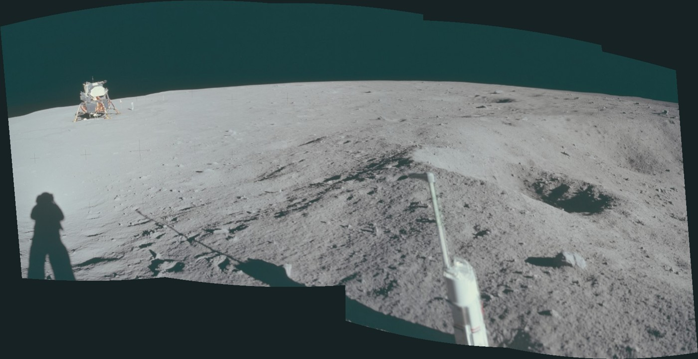

# Lumenstitch

Register an unordered set of overlapping photographs, inspect the evidence for each alignment, and render a planar or cylindrical panorama. The included demo starts with four separate Apollo 11 camera frames and runs without downloading a dataset or a model.



*Photographs by NASA / Neil Armstrong. The preview preserves the irregular coverage boundary and visible foreground parallax.* [Frame provenance](examples/apollo/CREDITS.md)

## Reconstruct the sample

```sh
python3 -m venv .venv
. .venv/bin/activate
python -m pip install .
lumenstitch examples/apollo/*.jpg --focal-px 810 --out result
python -m unittest discover -s tests -v
```

Requires Python 3.10+. A completed bundle contains an RGBA PNG and `alignment.json`. On the bundled frames, the local reference run produced a **1707 × 880** cylindrical canvas with **1,196,968** covered pixels. Four image pairs passed verification. The RMS coordinate residual of the sampled inlier correspondences was approximately **0.51 px** after joint refinement. This is a fit diagnostic. The suite separately measures held-out geometry on inputs with known transformations. Exact feature counts can vary across OpenCV builds.

## Registration pipeline

1. OpenCV extracts SIFT features. Two-way nearest-neighbor ratio tests supply candidate correspondences for each image pair.
2. A seeded adaptive RANSAC loop fits a normalized direct linear transform from four samples. Symmetric transfer error, support count and inlier spatial coverage determine which edges enter the match graph.
3. A graph center anchors the coordinate frame. A maximum-weight tree initializes image poses. Consistent redundant edges enter joint robust least squares in normalized coordinates, with residuals measured in pixel units in both directions.
4. With `--focal-px`, the pipeline maps the reference plane to a cylindrical surface and inverse-samples each source. Omitting the option produces a planar canvas. Input-to-reference transforms, output projection, accepted edges and gains are recorded in JSON.
5. Robust pairwise log-intensity differences estimate exposure gains. A distance-weighted Laplacian pyramid blends the warped frames. Geometric masks preserve valid black pixels and encode uncovered output as transparent.

Feature extraction, resampling, and pyramid primitives come from OpenCV. The estimator, graph initialization, pose objective, cylindrical mapping, exposure system and blending policy are implemented here. SciPy solves the nonlinear least-squares problem.

## Inspect a failure

Try a pair of non-overlapping photographs. A disconnected graph reports the unreachable frame indices and leaves the output unpublished. Try the four sample frames with and without `--focal-px 810` in different output directories to compare their footprints. A small `--max-pixels` allows you to test allocation rejection before rendering. The focal value for the bundled reduced scans is a rendering choice rather than a recovered camera calibration.

The motion model fits a single homography per frame. Strong translation, rolling shutter, moving objects, lens distortion, or nearby objects at different depths can leave seams. In the lunar example, close equipment moves relative to the distant surface. The cylindrical rendering uses one front-facing reference plane and rejects frames that cross its projective horizon. The implementation keeps warped images and masks in memory and limits the output canvas by default to ten million pixels.

## Numerical checks

The tests recover a planted transform with 68 outliers among 150 matches, compare held-out points on shuffled and exposure-shifted images, reject collinear samples, check gain recovery and black-pixel masks, and reconstruct the mission frames through the installed command's Python entry point.
